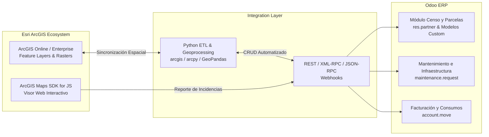

# 🌍 Agro-GIS & Odoo ERP Integration Suite


Ecosistema de soluciones modulares para la **integración bidireccional entre sistemas de información geográfica (Esri ArcGIS) y planificación de recursos empresariales (Odoo ERP)**. 

Este repositorio demuestra patrones de arquitectura geoespacial aplicados a la gestión de activos territoriales, infraestructuras hidráulicas, catastro y recursos agroambientales.

---

## 🏗️ Arquitectura del Sistema

El flujo de datos conecta los servicios espaciales de ArcGIS Online / Enterprise con la lógica de negocio y la base de datos de Odoo mediante APIs estándar:



---

## 📂 Estructura del Repositorio

```text
agro-gis-odoo-integration/
├── 01-parcel-cadastral-sync/      # ETL de sincronización parcelaria y titulares
├── 02-hydraulic-network-viewer/   # Visor web de activos y gestión de averías
├── 03-ndvi-water-billing-etl/     # Cálculo de dotaciones hídricas por teledetección
├── docker-compose.yml             # Entorno local reproducible (Odoo + PostgreSQL/PostGIS)
└── README.md
```

---

## 🚀 Proyectos Incluidos

### 1. Conector de Sincronización Parcelaria (`01-parcel-cadastral-sync`)
Pipeline ETL desarrollado en Python para mantener sincronizado el inventario territorial entre un *Feature Service* de ArcGIS y el censo administrativo en Odoo.
* **Funcionalidades:** Extracción de polígonos, superficies regables y referencias catastrales; detección de cambios geométricos y actualización automática de titulares (`res.partner`) y parcelas en Odoo sin duplicados.
* **Tecnologías:** `arcgis` (ArcGIS API for Python), `GeoPandas`, `xmlrpc.client`, GeoJSON / WKT.

### 2. Visor Web de Infraestructuras y Averías (`02-hydraulic-network-viewer`)
Aplicación web interactiva para la visualización y mantenimiento en campo de redes de distribución, hidrantes, válvulas y contadores.
* **Funcionalidades:** Renderizado de capas vectoriales de ArcGIS con simbología dinámica según estado operativo. Al seleccionar un activo en el mapa, el usuario puede notificar una incidencia que dispara una petición a Odoo, creando automáticamente una orden de trabajo (`maintenance.request`).
* **Tecnologías:** ArcGIS Maps SDK for JavaScript, HTML5/CSS3, Controladores HTTP REST en Odoo.

### 3. Análisis Hídrico y Facturación Automatizada (`03-ndvi-water-billing-etl`)
Flujo de geoprocesamiento orientado a la agricultura de precisión y la gestión eficiente del agua.
* **Funcionalidades:** Cruce espacial entre capas de parcelas de cultivo e imágenes ráster multiespectrales (índices de vegetación NDVI). Estimación de demanda hídrica por hectárea y generación automática de borradores de factura en el módulo de contabilidad de Odoo.
* **Tecnologías:** `arcgis.raster` / `arcpy`, `Pandas`, Jupyter Notebooks, API de Odoo.

---

## 💡 Casos de Uso Aplicables

* **Comunidades de Regantes e Infraestructuras Hidráulicas:** Gestión integral de comuneros, turnos de riego, redes de tuberías y telecontrol.
* **Ingeniería y Consultoría Agroambiental:** Inventario georreferenciado de explotaciones, auditorías de superficie y tramitación de expedientes.
* **Gestión de Activos Municipales y Utilities:** Mantenimiento preventivo y correctivo de redes de abastecimiento y saneamiento sobre cartografía oficial.

---

## 🛠️ Instalación y Despliegue Rápido (Entorno Local)

1. **Clonar el repositorio:**
   ```bash
   git clone https://github.com
   cd agro-gis-odoo-integration
   ```

2. **Levantar la instancia de Odoo y Base de Datos:**
   ```bash
   docker-compose up -d
   ```

3. **Configurar variables de entorno:**
   Renombra el archivo `.env.example` a `.env` en cada subproyecto e introduce tus credenciales de **ArcGIS Online/Enterprise** y tu instancia de **Odoo**:
   ```env
   ARCGIS_URL=https://arcgis.com
   ARCGIS_USERNAME=tu_usuario
   ARCGIS_PASSWORD=tu_password

   ODOO_URL=http://localhost:8069
   ODOO_DB=agro_gis_db
   ODOO_USERNAME=admin
   ODOO_PASSWORD=admin
   ```

---

## 👤 Autor

Desarrollado por **Luc Pinheiro** — *Especialista GIS & Desarrollador de Integraciones.*
* 🔗 [GitHub](https://github.com)
* 💼 [LinkedIn](https://linkedin.com)
